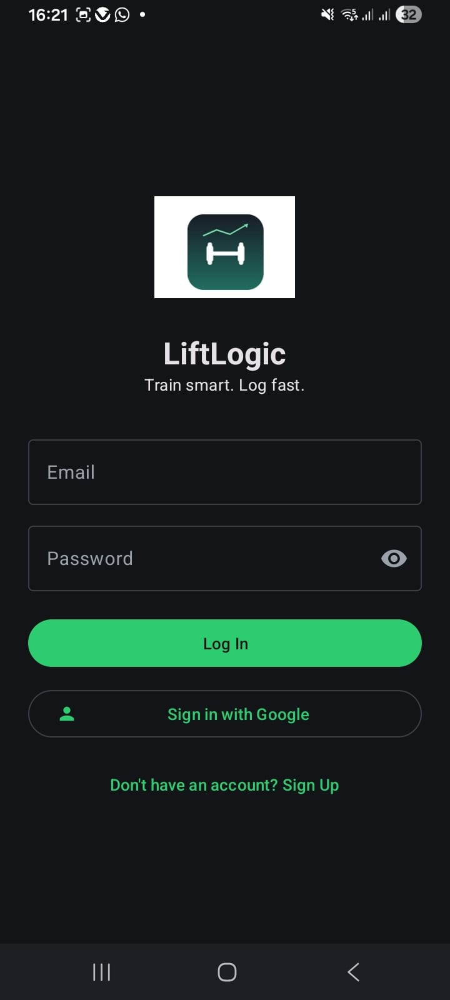
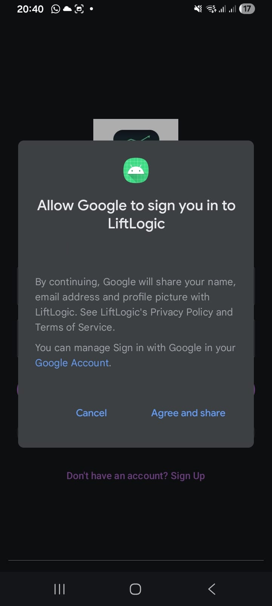
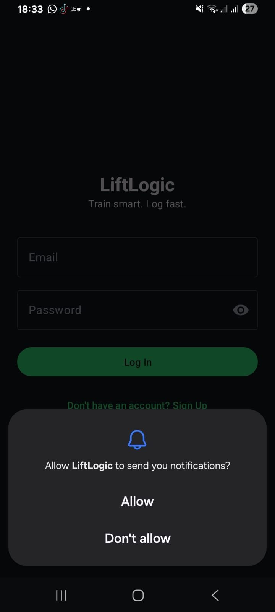
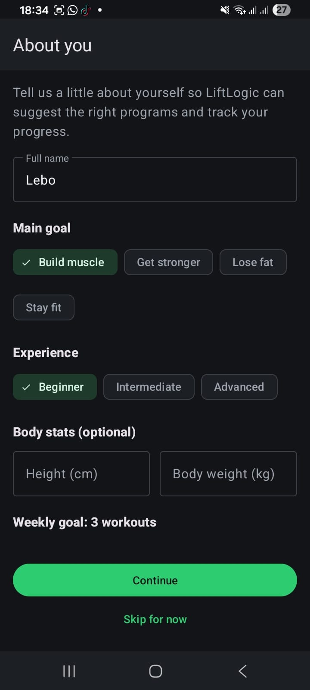
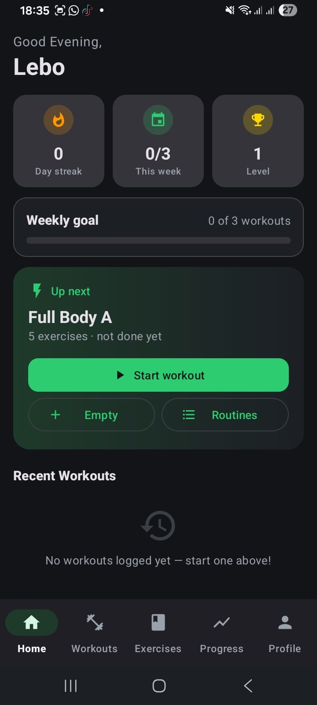
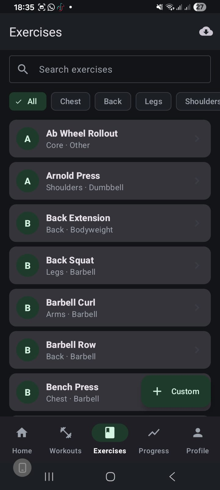
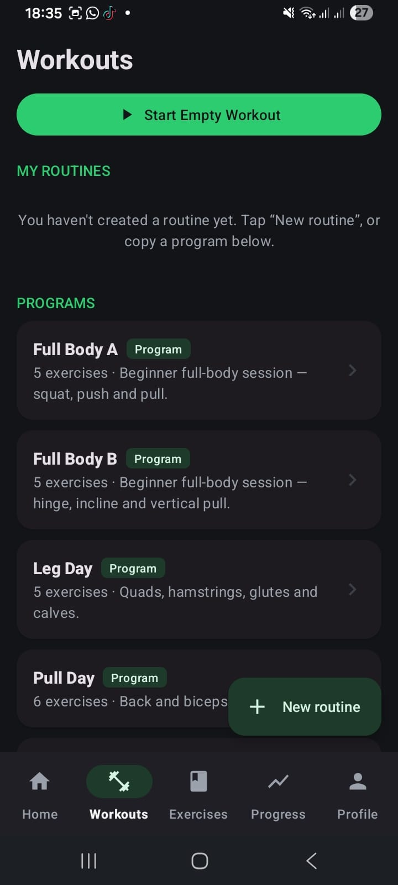
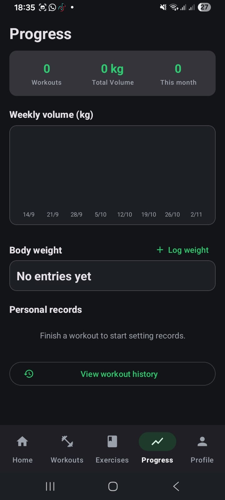
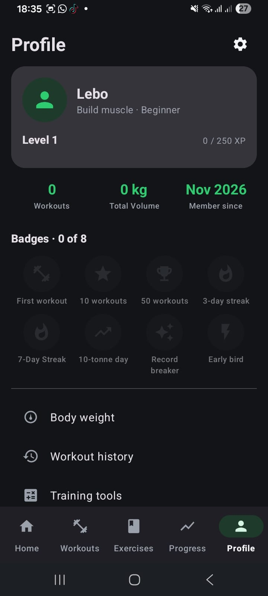

# 🏋️ LiftLogic

### *Train smart. Log fast.*

An Android workout-tracking app built with **Kotlin and XML layouts**

**OPSC6312 · Open Source Coding · Portfolio of Evidence, Part 3 (FINAL PoE)**

---

## Final PoE submission

This repository state is the **final PoE** for OPSC6312 Part 3. The final commit is tagged **`final-PoE`**.

| | |
|---|---|
| 🎥 **Demo video (voice-over)** | [Watch the demo video](https://youtu.be/IXFml846ed8) |
| 🏷️ **Final tag / release** | `final-PoE` (see the **Releases** section of this repo) |
| 📱 **APK** | [Download from the final-PoE release](https://github.com/OmphileMoale/LiftLogic/releases/tag/final-PoE) |
| 🧪 **Build status** | [GitHub Actions](https://github.com/OmphileMoale/LiftLogic/actions) |

**Team (DISD 3, Group 12):** Oladele Rakgolela (ST10449832) · Omphile Moale (ST10455873) · Lebo Ramoshaba (ST10453111)

---

## Table of contents
1. [Purpose](#1-purpose-of-the-app) · 2. [What the app does](#2-what-the-app-does) · 3. [Innovative features](#3-innovative-features) · 4. [Design considerations](#4-design-considerations) · 5. [Tech stack](#5-technology-stack) · 6. [Screenshots](#6-screenshots) · 7. [Part 3 checklist](#7-part-3-requirement-checklist) · 8. [GitHub and Actions](#8-github-and-github-actions) · 9. [Testing](#9-testing) · 10. [Release notes](#10-release-notes) · 11. [Part 1 to final](#11-from-the-part-1-design-to-the-final-app) · 12. [Google Play](#12-publishing-on-google-play) · 13. [Build and run](#13-how-to-build-and-run) · 14. [AI usage](#14-ai-tool-usage) · 15. [Limitations](#15-known-limitations-and-future-work) · 16. [References](#16-references)

---

## 1. Purpose of the app

Our Part 1 research into three existing fitness apps found that people abandon workout trackers for two opposite reasons: apps that are **too slow to use between sets** in a busy gym, and apps that are **too rigid** for the way a person actually trains. Many also give no reason to come back after the first week.

LiftLogic answers this with three pillars:

| Pillar | What it means in LiftLogic |
|---|---|
| **Speed** | Logging a set takes as few taps as possible. Previous performance is shown and a rest timer runs between sets. |
| **Structure** | Ready-made programs, user-built routines and a searchable exercise library replace messy notes. |
| **Motivation** | XP, levels, streaks, weekly goals and badges reward consistency. |

**Target user:** a regular gym-goer aged 16 to 40 who wants one tool to plan, log and review training.

**Goals:** let a new user start training within minutes; keep working with no signal; keep user data private; make progress visible.

---

## 2. What the app does

| Area | What the user can do |
|---|---|
| **Account** | Register and log in with email and password, or **Sign in with Google** (single sign-on) through Android Credential Manager. Passwords are never stored in plain text. |
| **Onboarding** | "About you": name, main goal, experience, optional height and body weight, weekly goal. Skippable. |
| **Home** | Day streak, workouts this week, level, weekly-goal bar, an "Up next" suggested workout, quick actions and recent workouts. |
| **Workouts** | Start an empty workout, build and save routines, or copy a ready-made program (Full Body A and B, Leg Day, Pull Day and more). |
| **Exercises** | Search, filter by muscle group, equipment labels, custom exercises, and browse and import more exercises from the online wger API. |
| **Active workout** | Log sets with weight and reps, see previous performance, and use a rest timer that notifies you when rest ends. |
| **Workout summary** | Duration, volume, XP and badges earned, plus sharing a text summary through the Android share sheet. |
| **Progress** | Workouts, total volume, this month, eight-week volume chart, body-weight log, personal records and history. |
| **Profile** | Level and XP bar, lifetime stats, eight badges, body-weight and workout history, and training calculators (1RM and plates). |
| **Settings** | Units, default rest time, reminders, theme and accent colour, language (English, Afrikaans, isiZulu), password and profile picture. |
| **Offline use** | Everything is saved in a Room database on the phone, so logging, routines, progress and history work with no connection. |
| **Notifications** | A rest-timer alert and a daily workout reminder, as Android notifications. |

---

## 3. Innovative features

All four features from our Part 1 plan are in the final app.

| Feature | How it works |
|---|---|
| **Gamification** | XP for every workout, levels (level 1 needs 250 XP), a day streak, a weekly-goal bar and **eight badges**: First workout, 10 workouts, 50 workouts, 3-day streak, 7-Day Streak, 10-tonne day, Record breaker, Early bird. |
| **Smart suggested workout** | The "Up next" card picks the routine done least recently (your own routines first, otherwise a ready-made program matching your experience). Part 1 planned a recovery-based rule; this rotation rule works from the user's own history. |
| **Rest timer with notification** | A timer between sets that sends a notification when rest ends. Notification permission is requested on Android 13 and above. |
| **Shareable workout summary** | After a workout, the user can share duration, volume and XP through the Android share sheet. Part 1 planned an image card; the final app shares text, which works in any app. |

---

## 4. Design considerations

- **User experience.** Dark theme with a green accent from the Part 1 prototype, consistent layout and fonts, a five-tab bottom navigation bar, empty states that tell new users what to do, and skippable onboarding.
- **Input validation.** The app checks input and shows messages instead of crashing.
- **Security and privacy.** Passwords are stored only as a random salt plus a SHA-256 hash in the app's private Room database. Sign in with Google uses Android Credential Manager to get a Google ID token, so LiftLogic never sees a Google password. Network calls use HTTPS, workout data stays in private app storage, and keystores are excluded from the repository.
- **Offline-first.** The Room database is the source of truth, so the app works with no signal. The trade-off is that data lives only on the phone for now (see section 15).
- **Architecture.** Layered code: `ui` (fragments and view models), `data` (Room and repositories), `network` (Retrofit), `notifications`, and `util` (XP, streak and volume calculations). XML layouts, ViewBinding and the Navigation Component. About 60 Kotlin files with comments.
- **Language support.** English, Afrikaans and isiZulu through Android's per-app language support, with all text in string resources. Some screens still fall back to English (see section 15).
- **Accessibility.** Large touch targets, strong contrast and labelled navigation icons.

---

## 5. Technology stack

| Layer | Technology |
|---|---|
| Language | Kotlin |
| UI | XML layouts, Fragments, ViewBinding, Navigation Component, Material Components, custom chart views (no Jetpack Compose) |
| Local database | Room (SQLite) |
| REST API | Retrofit with the wger exercise API |
| Authentication | Email and password accounts in Room, plus Sign in with Google (Credential Manager) |
| Notifications | Android notification channels and scheduled reminders |
| Testing | JUnit unit tests, GitHub Actions |
| Build | Gradle (Kotlin DSL), JDK 17 |

---

## 6. Screenshots

| Login | Google sign-in | Notifications | Onboarding |
|:---:|:---:|:---:|:---:|
|  |  |  |  |

| Home | Exercises | Workouts | Progress | Profile |
|:---:|:---:|:---:|:---:|:---:|
|  |  |  |  |  |

---

## 7. Part 3 requirement checklist

| Part 3 requirement | How LiftLogic meets it |
|---|---|
| Runs on a mobile phone | Built and tested on a physical Android phone. |
| Register and log in, password protected | Email and password accounts; only salted SHA-256 hashes are stored. |
| Single sign-on | Sign in with Google through Android Credential Manager. |
| Change settings | Units, rest time, reminders, theme, language, password and profile picture. |
| REST API | Public wger REST API through Retrofit; imported data is stored in Room. |
| NoSQL database | **Not in this version.** Data is in Room (SQLite). A NoSQL store such as Cloud Firestore is planned. |
| Offline mode with sync | Fully usable offline (Room). **Cloud sync is not in this version.** |
| Real-time notification | Rest-timer and daily-reminder notifications. Firebase Cloud Messaging push is planned. |
| Multi-language (two South African languages) | Afrikaans and isiZulu, plus English. |
| Part 1 features | Gamification, suggested workout, rest timer, shareable summary, exercise library, progress tracking. |
| App icon and final image assets | Dumbbell-and-trend-line icon from Part 1. |
| Handles invalid input | Validation with friendly messages. |
| GitHub, README, automated testing | This README, regular commits, and GitHub Actions that run unit tests and build the app. |
| Comments and logging | Comments throughout the code. |
| Release notes | Section 10. |
| Prepared for Google Play | Section 12. |

---

## 8. GitHub and GitHub Actions

**Version control.** All code is in this one repository with regular commits, a README, and **no zip files**. Keystores, APKs and `local.properties` are excluded by `.gitignore`. The commit history shows the move from Jetpack Compose to Kotlin with XML. The final commit is tagged **`final-PoE`** and released with the APK.

**GitHub Actions.** `.github/workflows/android-build.yml` runs on every push and pull request to `main`:

1. Check out the code
2. Set up JDK 17
3. Grant execute permission to `gradlew`
4. Run the unit tests (`./gradlew testDebugUnitTest`)
5. Build the debug APK (`./gradlew assembleDebug`)
6. Upload the test reports and the APK as artifacts

A green tick means the code compiles and the tests pass on a clean machine.

**What we learned.** In Part 2 the workflow failed three times in a row. We read each failed run's log in the Actions tab, traced the problems to the Gradle wrapper version and JDK setup, fixed `gradle-wrapper.properties` and the workflow, and the build passed on commit `4c70f0d`.

**Limitation.** The debug APK built by Actions is signed with a different debug key from the one registered for Sign in with Google, so Google sign-in does not work in that APK. Actions proves the code builds and passes its tests; demo builds are made in Android Studio.

---

## 9. Testing

**Automated.** JUnit tests for the training logic (XP and levels, streaks, volume and badge rules) run on every push through GitHub Actions. Run them locally with `./gradlew testDebugUnitTest`.

**Manual test cases used on a physical phone:**

| # | Test | Expected result |
|---|---|---|
| 1 | Register with valid details | Account created, onboarding opens |
| 2 | Empty field, invalid email or short password | Clear message, no crash |
| 3 | Wrong password at login | Clear message, no crash |
| 4 | Sign in with Google | Signed in, Home opens |
| 5 | Onboarding, then Skip for now | Both reach Home |
| 6 | Search and filter exercises | List updates |
| 7 | Log sets and finish a workout | In history, XP and volume update |
| 8 | Letters or negative numbers as weight or reps | Rejected with a message |
| 9 | Change units and language | App updates and keeps the choice |
| 10 | Airplane mode, log a workout | Logging still works |
| 11 | Rest timer ends with app in background | Notification appears |
| 12 | Unlock a badge | Badge shows on Profile |

---

## 10. Release notes

### Final PoE (November 2026)

The prototype (Part 1) was a design document with wireframes. Part 2 was a working app built with Jetpack Compose. This is the final app.

**Changed in response to lecturer feedback**
- The UI was rebuilt with **Kotlin and XML layouts**. Jetpack Compose was removed.

**Innovative features added or improved in this version**
- **Gamification:** eight-badge collection, XP levels with a progress bar, streaks and weekly goals (the prototype showed two example badges).
- **Smart suggested workout:** "Up next" card on Home with one-tap Start.
- **Rest timer with notification.**
- **Shareable workout summary** through the Android share sheet.
- **Offline-first logging:** all data is saved on the phone first.

**New features since the prototype**
- Registration, login and **Sign in with Google**
- Onboarding with goal, experience, body stats and weekly goal
- Ready-made programs and user-built routines
- Searchable exercise library, custom exercises and online import from wger
- Progress screen: volume chart, body-weight log, personal records, history
- Profile with level, XP, badge grid and training calculators
- Settings: units, rest time, reminders, theme, accent colour, language, password, profile picture
- English, Afrikaans and isiZulu interface languages
- Workout history with detail view and repeat-workout shortcut
- Daily workout reminder that survives a phone restart, and resume of an unfinished workout
- Notification permission handling for Android 13 and above
- Five-tab navigation with a dedicated Exercises tab
- GitHub Actions workflow that runs unit tests and builds the app

**Changed from the Part 1 design**
- No custom server: exercises come from the public wger API and user data is stored on the phone instead of in Firestore.
- XP, streak and badge calculations run inside the app. Cloud storage, Firebase push notifications and background sync are not in this version.
- Five bottom-navigation tabs instead of four.
- Rotation-based suggested workout and text (not image) shareable summary.

**Known issues**
- The floating New routine and Custom buttons overlap the last visible list item on Workouts and Exercises.
- Some screens are not yet fully translated and fall back to English.

---

## 11. From the Part 1 design to the final app

| Part 1 requirement | Final status | Notes |
|---|---|---|
| FR1 REST API | Met, with a change | wger API instead of the planned Express and ExerciseDB server |
| FR2 Authentication | Met | Email and password, plus Google sign-in |
| FR3 Core use case | Met | |
| FR4 At least 8 screens | Exceeded | More than 20 screens |
| FR5 Validated input stored locally and remotely | Met locally | Room; no remote storage in this version |
| FR6 Exercise library | Met | Seeded exercises plus wger import |
| FR7 Progress charts | Met | Weekly volume chart, body-weight chart, per-exercise charts and personal records based on estimated 1RM |
| FR8 Gamification | Met | XP, levels, streaks, eight badges |
| FR9 Push notifications | Met locally | Rest-timer and reminder notifications; no FCM push |
| NFR1 Fast logging | Met | A set is logged by entering weight and reps and ticking it; the rest timer then starts automatically |
| NFR2 Offline resilience | Met locally | Room; no cloud sync |
| NFR3 Security | Met | Salted password hashes, HTTPS, private app storage |
| NFR4 Testing | Met | Unit tests in Actions and manual phone testing |

---

## 12. Publishing on Google Play

The Play Store preparation (store listing text, assets, signing plan and policy checklist) is documented in **Section 3** of the submitted Word document. The release package name is `com.oladele.liftlogicgym`, which is registered for Google sign-in.

New personal Play Console accounts must run a closed test with at least 12 testers for 14 days before applying for production access, so the app is **ready to publish** once that period is complete.

---

## 13. How to build and run

**Requirements:** Android Studio, JDK 17, an Android phone with USB debugging.

1. `git clone https://github.com/OmphileMoale/LiftLogic.git`
2. Open the folder containing `settings.gradle.kts` in Android Studio and wait for the Gradle sync.
3. Connect your phone and press **Run**.
4. Or download the APK from the `final-PoE` release.

---

## 14. AI tool usage

We used Claude (Anthropic) for planning against the rubric, reviewing our project files, drafting documentation, and Git and Play Store guidance. We checked everything against the real app. The full cited write-up (500 words maximum) is submitted separately. It is Section 4 of the submitted Word document.

---

## 15. Known limitations and future work

- No cloud copy of the data yet: cloud backup and sync (for example Cloud Firestore) would let users restore data on a new phone.
- Push notifications through Firebase Cloud Messaging are planned, in addition to the local ones.
- Password hashing is a salted SHA-256 hash; a slower function such as PBKDF2 would be stronger.
- Exercise demo images or videos are not included yet.
- The shareable summary is text; an image card is planned.
- A recovery-based workout suggestion per muscle group is planned.
- More badges, challenges and languages.

---

## 16. References

- Android Developers (2026) *Room persistence library*. Available at: https://developer.android.com/training/data-storage/room (Accessed: 5 November 2026).
- Android Developers (2026) *Navigation component*. Available at: https://developer.android.com/guide/navigation (Accessed: 5 November 2026).
- Android Developers (2026) *Sign in your user with Credential Manager*. Available at: https://developer.android.com/identity/sign-in/credential-manager (Accessed: 5 November 2026).
- Anthropic (2026) *Claude* [Large language model]. Available at: https://claude.ai (Accessed: 5 November 2026).
- GitHub (2026) *GitHub Actions documentation*. Available at: https://docs.github.com/actions (Accessed: 5 November 2026).
- Pressman, R.S. and Maxim, B.R. (2020) *Software Engineering: A Practitioner's Approach*. 9th edn. New York: McGraw-Hill.
- wger (2026) *wger REST API*. Available at: https://wger.de/api/v2/ (Accessed: 5 November 2026).
